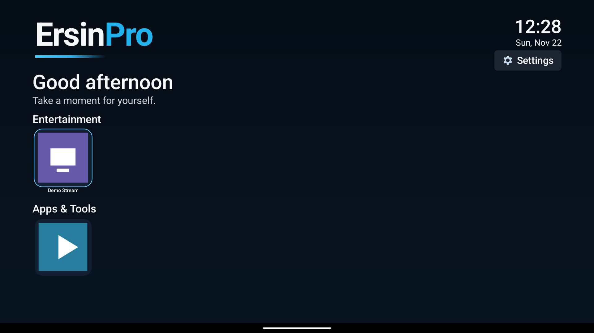

[English](README.md) | [Deutsch](docs/README.de.md)

# ErsinPro

*Native Android TV launcher for D-pad navigation on low-memory devices.*

ErsinPro is a native Java launcher for TVs and projectors operated with a D-pad. It was built and tested on a Yasomi Optive X5 running Android 9 (API 28) with 1 GB RAM.

**On the physical X5, the transition from the factory launcher’s first draw to ErsinPro’s first draw fell from about 91.9 s to 3.627 s.** The comparison used one controlled reboot per version. [Measurement and limits](docs/performance.md)

## Modern Clean screenshots



*English UI, Android 13 emulator, 1920 × 1080, showing project test apps in Focus Mode.* [English UI at 1280 × 720 on the same Android 13 emulator](docs/media/home-v0.2.7-720p.png)

Third-party application names, logos and icons shown in screenshots are the property of their respective owners. They appear solely to demonstrate launcher functionality and do not imply affiliation or endorsement.

## Features and navigation

- Two independently scrolling rows for Entertainment and Apps & Tools, with installed application icons.
- Automatic and manual categories, favorites, custom ordering, home visibility controls, and Focus Mode.
- English, Turkish and German, with localized dates, greetings and menus.
- Local preferences and recovery from an unreadable configuration. The app requests no Internet permission and runs no persistent service.

Use Up and Down to move between the header and rows, Left and Right to browse a row, and OK to launch an app or open Settings. Hold OK on a card, or open **Settings → Manage applications**, for app options. Back on a card moves focus to Settings. When an external app returns control to ErsinPro, the launcher restores the selected card if it is still visible.

In **Manage applications → Kodi**, choose **Hide from home** or **Show on home**. This local choice follows the Kodi package even if its launch activity changes. Recognized Optive X5 units receive a one-time hide default. Firmware that reports a generic model needs the explicit choice once. The factory launcher and casting apps keep their own visibility settings.

## Real hardware validation

The reference Yasomi Optive X5 runs Android 9 (API 28) on ARMv7 with 1 GB RAM and a D-pad remote. Physical testing used ADB over TCP/IP and logcat to trace HOME resolution and ActivityManager events. The firmware can explicitly start its factory launcher even while ErsinPro remains the preferred Android HOME.

v0.2.6-alpha added a one-shot start via `BOOT_COMPLETED`. v0.2.7-alpha also handles `LOCKED_BOOT_COMPLETED` when user storage is available, with ordinary boot completion as the fallback. The physical run verified foreground persistence for 120.3 seconds and checked Settings, FileManager and Back focus restoration. The previous same-signed APK provides the rollback path. [Hardware results and rollback](docs/compatibility.md)

## Measured performance

| X5 measurement | Result |
| --- | --- |
| Factory launcher first draw to ErsinPro first draw, v0.2.6-alpha | About 91.9 s |
| Same interval, v0.2.7-alpha | 3.627 s |
| Reduction in that interval | About 96.1% |
| Physical memory snapshot, v0.2.6-alpha | 36,858 KiB total PSS (about 36 MiB) |

The timer starts at the factory launcher’s first draw. Total power-button-to-home time was outside the measurement. The comparison uses one observed reboot per version on the tested X5. The PSS result is a point-in-time process sample. [Measurement methods and emulator baselines](docs/performance.md)

## Architecture and repository

| Path | Responsibility |
| --- | --- |
| `launcher/src/org/ersinpro/launcher/` | Native home and focus handling, app discovery, icon cache and preference model |
| `launcher/res/` | Themes, app-owned artwork and localized strings |
| `tests/` | Model tests, Android instrumentation and the external-player fixture |
| `tools/` | PowerShell build, test and emulator automation |
| `.github/workflows/` | Android build and emulator CI |
| `docs/` | Design decisions, compatibility records and performance protocols |

The two native horizontal scrollers cache icons near the viewport and release offscreen drawable references. Cards use a bounded bitmap cache and retain lightweight views for the catalog. A thin focus outline keeps the focus boundary stable without enlarging the card. The safe area derives from display dimensions in dp. [Architecture decisions](docs/architecture.md)

## Build and installation

Install JDK 17, PowerShell 7, Android SDK Platform 34 and Build Tools 34.0.0. Set `ANDROID_HOME` or pass `-SdkRoot`. Windows also checks the standard Android Studio SDK path.

```powershell
./tools/test.ps1
./tools/build.ps1 -Lint
```

The build outputs `build/ersinpro-debug.apk` and generates a local debug signing key on first use. If the Windows Lint launcher fails on a path with spaces, pass `-LintJar` with the SDK's `lib/lint-classpath.jar`.

Copy the APK to USB media and open it through the projector's file manager. Temporarily allow installation from that source if Android prompts. Launch ErsinPro from the factory app list and keep the current HOME selection during physical validation. In-place updates require the same signing key. The factory app list remains the rollback route during testing.

## Testing and CI

For local functional testing, use a disposable emulator with an English system locale and run `./tools/test-ui.ps1 -Serial emulator-5554`. CI runs the build, model tests, localization checks, Lint and the remote suite on API 28 at 720p and API 33 at 1080p. The suite covers navigation, preference recovery and return from a separate test player. [Android verification workflow](https://github.com/ersin-simsek/ErsinPro-Launcher/actions/workflows/android.yml)

## Compatibility and known limitations

The early automatic start was verified on the physical X5. OEM firmware can still intercept HOME and open its own launcher. The boot receiver uses Android APIs and requires neither root nor firmware modifications. Behavior can vary across devices and firmware versions. [Compatibility and physical acceptance](docs/compatibility.md)

## Development Approach

ErsinPro was developed with assistance from OpenAI Codex. The project owner guided and evaluated the requirements, technical decisions, hardware integration, debugging, and validation. AI-assisted code generation was combined with automated testing and hands-on verification on the physical Yasomi X5.

## Development and roadmap

The current development version is v0.2.7-alpha. Next validation steps are repeated X5 reboots, controlled warm-start and memory measurements, and remote testing at supported display outputs. Device profiles, diagnostics and adaptive performance are planned. [Changelog](CHANGELOG.md) · [Release process](docs/release.md)

## Contributing and license

Describe your device or emulator and include focused regression results. ErsinPro is licensed under Apache License 2.0. [Contributing](CONTRIBUTING.md) · [License](LICENSE)